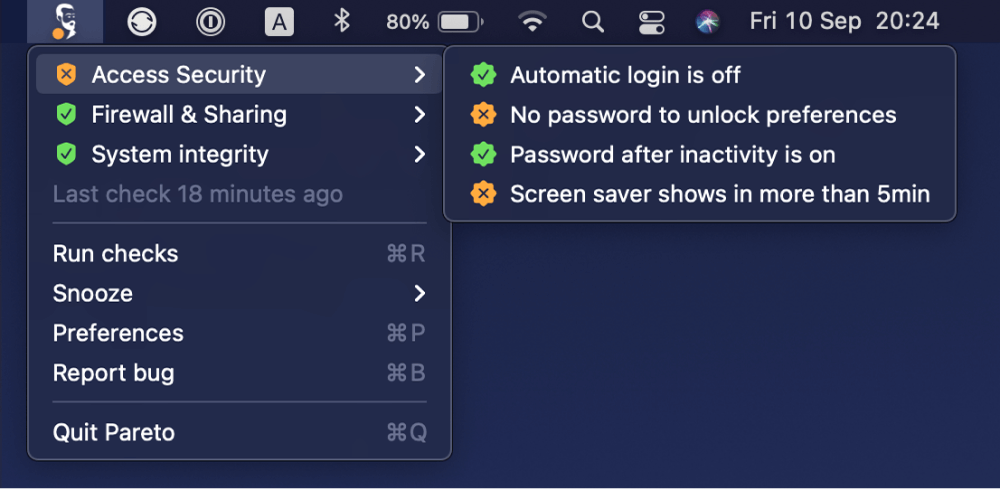

# Security checklist app for your Mac

[Pareto Security](https://paretosecurity.com/) helps you with basic security hygiene on your Mac. It gently nudges you to take care of 20% of security tasks that prevent 80% of problems.

<p align="center">
  
</p>

<p align="center">
  <a href="https://codecov.io/gh/ParetoSecurity/pareto-mac">
	
  </a>
  
  </a>
  <a href="https://github.com/ParetoSecurity/pareto-mac/releases">
    
  </a>
  <a href="https://github.com/ParetoSecurity/pareto-mac/blob/master/LICENSE">
    
  </a>
  <a href="https://github.com/ParetoSecurity/pareto-mac/graphs/contributors">
    
  </a>
</p>


## How Pareto Security keeps you secure

- Chris **forgot to enable FileVault** disk encryption after OS reinstall, then someone stole his MacBook, and now they have all of his photos, documents, and business files.
- Suzie **turned off the Firewall** to debug a router, did not remember to turn it back on, and accidentally exposed her local webserver to the entire Starbucks network.
- James lent his MacBook to mom for a weekend, forgot he enabled **automatic login** for her convenience, then found his son playing on his company's Slack.
- Paul needed to **turn off Gatekeeper** to install an app he found on the Internet, then failed to turn it back on again, and his Mac got infected with malware.
- Marie did not set **auto-updating of apps** and got hacked because she was not running a recent app version with the security patch applied.
- Mia used her MacBook for a presentation, disabled **automatic screen locking**, forgot to re-enable it, only to find coworkers having fun with her Facebook.


<p align="center">
  <a href="https://www.youtube.com/watch?v=eOrn62dBVwY"></a>
</p>

All of the above are easily preventable. The Pareto Security app regularly checks such common security fails and reminds you to take care of them.

[See all security checks on our website »](https://paretosecurity.com/security-checks)


## More info

Any other checks that you want? Let us know on [GitHub discussions](https://github.com/ParetoSecurity/pareto-mac/discussions/3).

[Contact us through the form](https://paretosecurity.com/contact) on our website.

Read more about the company behind the app: [niteo.co](https://niteo.co/)

## Releases

Our versioning strategy follows a specific pattern for stable and pre-release versions:

### Version Numbering

- **Stable releases** use the minor version (e.g., `1.10.0`, `1.11.0`)
- **Pre-releases** use patch versions (e.g., `1.10.1`, `1.10.2`, `1.10.3`)

### Example Release Cycle

```
1.10.0 - stable
1.10.1 - pre-release
1.10.2 - pre-release
1.10.3 - pre-release
1.10.4 - pre-release

1.11.0 - stable
1.11.1 - pre-release
```

**Note:** This versioning strategy applies only to Apple/macOS releases. Linux releases don't include pre-release versions.

### Troubleshooting

### SSH configuration checks

The SSH agent forwarding and host key verification checks inspect the configuration for a randomly generated hostname. They run Apple's SSH client inside a sandbox that prevents child processes, network access, and file writes. If evaluating the configuration requires a `Match exec` command, the checks report an error without running that command. Invalid configurations and failures to start the sandbox also report an error. These checks depend on macOS's deprecated `sandbox-exec` utility and never fall back to unsandboxed execution.

SSH key checks retain the Homebrew preference needed for hardware-backed keys on older macOS versions. Both Apple and Homebrew `ssh-keygen` run in a restricted subprocess that can read supported tool installations, selected configuration files, and the key being inspected with its public-key file. Other user-file contents, file writes, and network access are blocked.

### Package manager checks

Package manager version commands and login-shell PATH discovery run inside a sandbox that allows reading supported tool installations and selected configuration files, without inheriting the app's environment. Network access, file writes, and reads of other user-file contents are blocked. Versions are accepted only from stdout after a successful exit. A failed, timed-out, or blocked command reports an error instead of a passing result. Custom installation layouts may require additional read permissions before their versions can be checked.

### Helper commands (1.2.0+)

Copy/paste them into your browser address bar.

```
paretosecurity://reset > Default settings

paretosecurity://showMenu > Open menu

paretosecurity://update > Force update

paretosecurity://welcome> Show welcome window

paretosecurity://open > Start app

paretosecurity://showPrefs > Show Preferences

paretosecurity://runChecks > Run Checks

paretosecurity://restart > Restart app

paretosecurity://debug > Output detailed status of the checks

paretosecurity://logs > Copy system logs for ParetoSecurity
```

### Reset AppleWvnets (Automation) permissions

To reset privacy permissions run the following in Terminal: `tccutil reset AppleEvents`

More info at https://apple.stackexchange.com/questions/339363/how-can-i-remove-applications-from-security-privacy.

